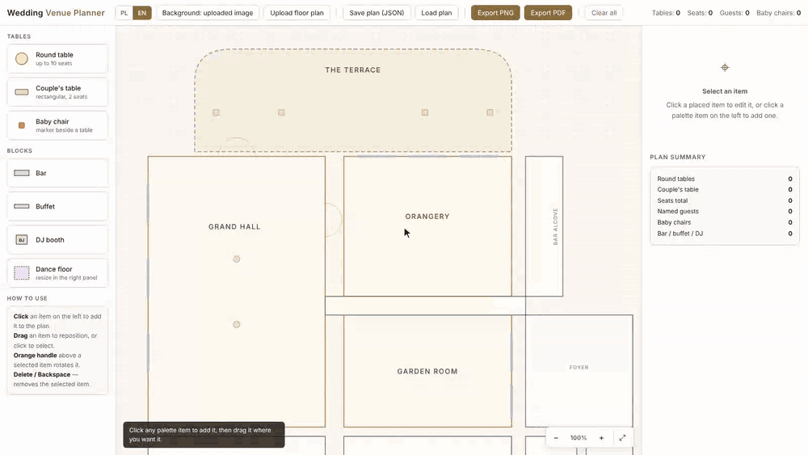
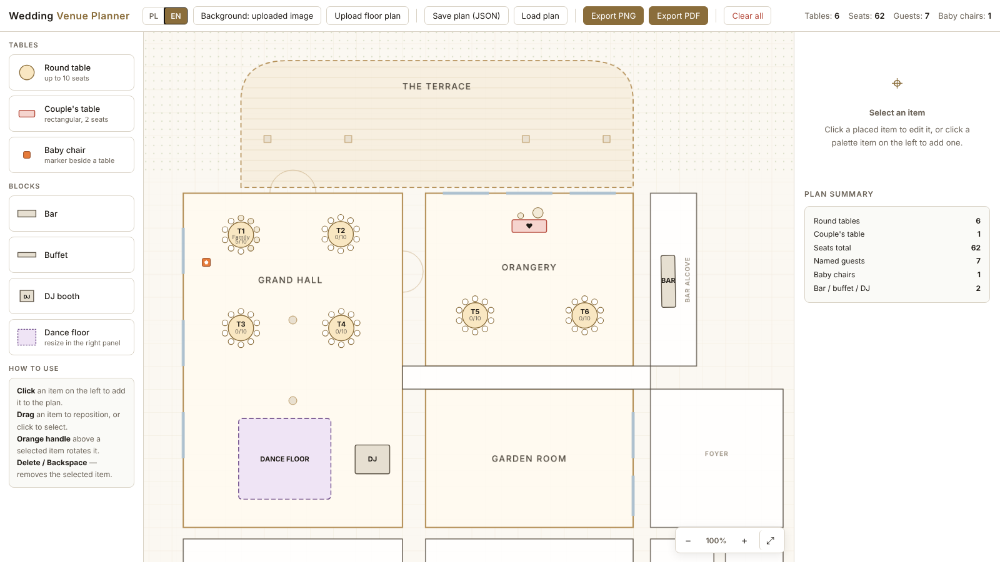
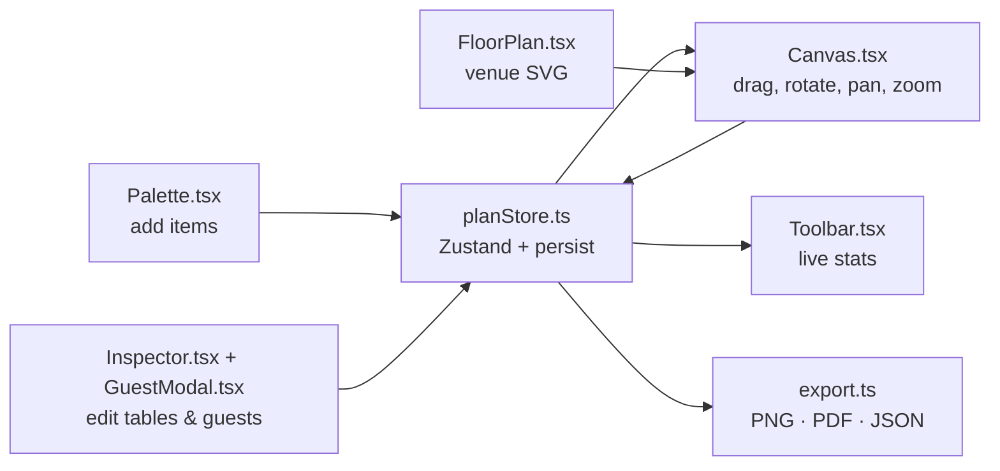

<div align="center">

# Wedding Venue Planner

**Lay out the tables, seat your guests and print the plan, all in the browser.**<br />
Drag round tables, the couple's table, a bar, DJ booth and dance floor onto the venue, fill in each table's guest list, then export a PNG or PDF.




<sub>The demo uses a made-up venue (<code>docs/sample-floor-plan.png</code>) uploaded as the background. Guest names are made up too.</sub>

</div>

## Why

Seating plans for a wedding usually end up as a spreadsheet plus a hand-drawn sketch of the room, and the two drift apart quickly. This puts both in one place: the floor plan is the editor, every table carries its own guest list, and the live counters show how many seats and named guests you have so far. When it's done, you can export it as one image for the venue coordinator or as a PDF with the full guest list per table.

It ships with a built-in plan of the venue it was originally made for, but it works just as well with any floor-plan image you upload as the background. To try that, upload [`docs/sample-floor-plan.png`](docs/sample-floor-plan.png), the made-up venue used in the demo.

## Quick start

```bash
npm install
npm run dev
```

Vite serves the app at `http://localhost:5173`. Click anything in the left palette to drop it onto the plan, then drag it into place.

Other scripts:

```bash
npm run build       # tsc --noEmit && vite build → dist/
npm run preview     # serve the production build
npm run typecheck   # tsc --noEmit only
```

## Features

<table>
<tr>
<td width="50%" valign="top">

**Build the layout**
- Round tables (up to 14 seats, 10 by default), a rectangular couple's table and baby chairs
- Bar, buffet, DJ booth and dance floor blocks, each resizable
- Drag to move, orange handle to rotate, <kbd>Delete</kbd> to remove
- Duplicate any item from the inspector

</td>
<td width="50%" valign="top">

**Seat the guests**
- Per-table name, number, seat count and baby-chair count
- Guest list editor for every seat, with an empty / filled marker on the plan
- Partner names on the couple's table
- Live totals: tables, seats, named guests, baby chairs

</td>
</tr>
<tr>
<td width="50%" valign="top">

**Export and save**
- PNG of the whole plan, rendered at 2× resolution
- A3 landscape PDF, plus extra pages listing guests by table
- Save / load plans as JSON
- Auto-save to `localStorage`, so closing the tab loses nothing

</td>
<td width="50%" valign="top">

**Floor plan and language**
- Built-in SVG plan of the venue, with the seating rooms highlighted in gold
- Or upload your own floor-plan image as the background
- Wheel zoom centred on the cursor, pan, fit-to-venue
- Polish (default) and English UI, switchable from the toolbar

</td>
</tr>
</table>

<p align="center">
  
</p>

## Controls

| Input | Action |
|---|---|
| Click a palette item | Add it to the centre of the current view |
| Click / drag an item | Select / move it |
| Drag the orange handle | Rotate the selected item |
| Drag empty canvas | Pan |
| Mouse wheel | Zoom in / out around the cursor |
| <kbd>+</kbd> <kbd>−</kbd> <kbd>0</kbd> | Zoom in / out / reset |
| <kbd>Delete</kbd> / <kbd>Backspace</kbd> | Delete the selected item |
| <kbd>Esc</kbd> | Deselect / close the guest list |

## How it works



All state lives in one Zustand store (`src/store/planStore.ts`) that is persisted to `localStorage`. Items are a discriminated union (`src/types/index.ts`), so each item type has its own inspector form and SVG renderer. Rendering is plain SVG, with no canvas or diagram library. Export serialises that same SVG, rasterises it to a canvas and hands it to jsPDF for the PDF.

### Using a different venue

The quickest route is **Upload floor plan** in the toolbar. The image is stretched over a 2600 × 1271 canvas, so a plan exported at that size (or that aspect ratio) lines up best. [`docs/sample-floor-plan.png`](docs/sample-floor-plan.png) is an example.

For a vector plan with highlighted rooms, `src/components/FloorPlan.tsx` draws the venue with a `viewBox` of `0 0 2600 1271`, matching the original floor-plan image, and each room is one `<path>` or `<rect>`. Rooms where guests are seated get the `priority` class, which gives them the gold border. To adapt it, replace that JSX with your own room geometry.

## Project layout

```
src/
├── App.tsx                 # Toolbar + Palette + Canvas + Inspector
├── components/
│   ├── Toolbar.tsx         # file actions, exports, language toggle, stats
│   ├── Palette.tsx         # items you can add
│   ├── Canvas.tsx          # SVG viewport: drag, rotate, pan, zoom
│   ├── FloorPlan.tsx       # venue rooms as SVG
│   ├── PlacedItem.tsx      # renderers for each item type
│   ├── Inspector.tsx       # right-hand properties panel
│   └── GuestModal.tsx      # per-seat guest list
├── store/planStore.ts      # Zustand store, persistence, stats
├── i18n/                   # PL + EN dictionaries and t() hook
├── lib/export.ts           # PNG, PDF, JSON save/load
└── types/index.ts          # item types
```

## Roadmap ideas

- Drag guests between tables
- Import a guest list from CSV
- Dietary and RSVP notes per guest
- Hosted version on GitHub Pages

---

<div align="center">
<sub>Built by <a href="https://github.com/Gabrielasu">@Gabrielasu</a> · MIT licensed</sub>
</div>
